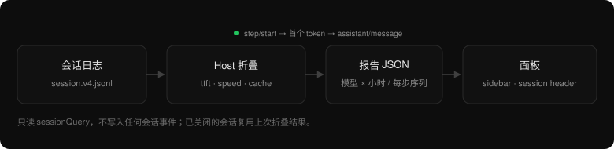

# dsh-latency-stats

DSH（DeepSeek Harness）插件：统计每个模型的**首 token 延迟**、**输出速度**与**缓存命中**，按每天的时间段分组，覆盖当前对话与全部历史会话，并给出单个会话内每一步的缓存命中率曲线。



## 功能

- **按小时分布**：首 token 延迟 / 输出速度两张柱状图，带纵轴刻度；可按模型过滤。
- **模型明细**：步数、首 token 平均 / P50 / P90、输出速度平均 / P50、流式生成速度、缓存命中、平均输出、累计 tokens。可选择显示哪些模型（状态存在浏览器本地）。
- **缓存命中率曲线**：x 轴是会话内的响应次序，y 轴是命中率；悬停显示该次的时间、上下文与缓存读取量；命中率大幅下降的点按原因着色，并在下方列出可能原因。
- **最近响应**：最近 24 次模型响应的明细。

## 安装

在 DSH 的 **插件** 页面选择「添加插件 → 本地目录」，指向本仓库目录即可；或用 `plugin_manager`：

```
plugin_manager action=install_bundle target=<本仓库绝对路径>
```

安装后刷新页面，侧栏底部（设置按钮旁）会出现「模型性能」，会话标题栏右侧还会多一个图标，可直接查看当前会话。

## 指标口径

- **首 token 延迟** = 该步 `step/start` → 首个输出 token（第一段非空文本 / 推理片段，或第一个带名字的工具调用增量），从持久化的流记录（`time0` + 累积 `dt`）还原，历史会话同样可复算。
- **输出速度**（主指标）= 输出 tokens ÷（`step/start` → `assistant/message` 落地），含首 token，所有供应商可比。
- **流式生成速度** = 输出 tokens ÷（首个 token → 落地），只统计真实分批到达（解码窗口 ≥ 100ms）的步。有些供应商把整段回复一次吐出，用解码窗口会得到明显偏高的假数字，所以它只作参考列。
- **缓存命中** = `cacheReadTokens ÷ (inputTokens + cacheReadTokens + cacheWriteTokens)`，与 DSH 内置「统计」页签一致。
- 平均值按 token 加权，P50 按步取中位数；时间按本机时区分桶。

命中率下降的归因规则见 [docs/DETAIL.md](docs/DETAIL.md)。

## 实现

- `index.js`（Host）：用 `sessionQuery.listSessions()` / `readSession()` 读取持久化会话日志，折叠出每一步的首 token 延迟、输出 tokens、缓存命中与上下文大小，聚合成「模型 × 小时」矩阵与单会话序列，通过 `GET /latency-stats/api/report` 提供 JSON（页面同源、带浏览器凭据校验）。
- `client.js`（Web）：在 `sidebar.footer.action`、`conversation.session.header.utilities` 注册入口，在 `shell.overlay` 注册面板；使用 `--dsw-alias-*` 主题 token，样式跟随 DSH 的深浅色主题。
- 已关闭的会话不会重复读取：持久化日志在非 live 状态下不再新增事件，重复扫描只重读活跃会话；冷扫描并发 6 个。

## 开发

```powershell
npm run check        # node --check 两个入口文件
npm test             # 合成日志上的口径校验（无需本机数据）
npm run test:e2e     # 真实会话日志 + React 服务端渲染
```

`test/e2e.mjs` 读取本机 `~/.dsh/sessions`（只读），并需要 React 18：

- `DSH_SESSIONS_DIR`：会话日志目录，默认 `~/.dsh/sessions`
- `REACT_RESOLVE`：任意已安装 react + react-dom 的 `package.json` 绝对路径；或在仓库内 `pnpm add -D react react-dom`

## 限制

- 手动中断的步没有 `assistant/message`，不计入任何时间、速度与缓存统计。
- 没有 `usage` 记录的步只参与首 token 统计。
- 缓存曲线最多保留 2000 个点，超出时按步抽样并标注。
- 统计以 Host 进程为边界，缓存不落盘；关闭 DSH 后下次打开重新扫描。
- 界面文案提供中文与英文，其它语言回落到英文。

## 许可

MIT
